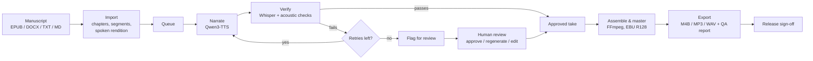

# Audiobook Studio

**Turn finished manuscripts into finished audiobooks on your own Mac, with no uploads, no subscriptions and no narration booth.**


Audiobook Studio is a local, autonomous audiobook production studio for Apple Silicon Macs. You upload EPUB, DOCX, TXT or
Markdown manuscripts in the browser, pick a narrator for each book and queue them. The Mac then narrates every book on its
own GPU, checks each passage with an independent speech recognizer, and flags only the passages a person needs to hear.
You review those passages in the same web console, fix them, and export chapter-marked audiobooks.

Everything runs on your machine. Narration uses Qwen3-TTS through mlx-audio,
verification uses Whisper through mlx-whisper, mastering uses FFmpeg and state lives in SQLite. Manuscripts and voice
recordings never leave the Mac, and there is no telemetry.

---

## Contents

- [Features](#features)
- [How it works](#how-it-works)
- [Requirements](#requirements)
- [Installation](#installation)
- [First steps](#first-steps)
- [Updating, uninstalling and migrating](#updating-uninstalling-and-migrating)
- [Privacy and security](#privacy-and-security)
- [Limits](#limits)
- [Documentation](#documentation)
- [Development](#development)
- [License](#license)

---

## Features

**Production**
- **Batch import** of EPUB (in spine order), DOCX, TXT and MD. Each file gets a preview of its chapters, word and segment
  counts, and exactly what will and will not be read aloud (images, tables, footnotes, navigation, code).
- **A durable queue.** One GPU worker narrates the books in the order you set. You can reorder, pause, resume, retry and
  cancel. A crash, sleep or restart picks up where it left off, and one failed book never stops the others.
- **Hands-off generation.** The Mac stays awake while jobs run, and every attempt is saved as it happens.

**Quality control**
- **Every segment is checked twice:** Whisper transcribes the take and the studio compares it word by word with the text,
  and acoustic checks catch clipping, dead air, wrong levels and suspicious durations.
- **Automatic retries** with a new seed and temperature (3 attempts by default). If all attempts fail, the best take is kept
  and the segment is flagged for a person instead of blocking the book.
- **A review workspace** with the original text, the spoken rendition and the transcript side by side, a word diff, every
  take with its own player, and keyboard shortcuts (`J`/`K`, `A`pprove, `R`egenerate, `E`dit, `P`lay).

**Voices**
- **Built-in narrators** (Ryan and Aiden), **designed voices** created from a written description, and **authorised clones**
  made from a 5 to 15 second clip of a voice you own or have written permission to use.
- **A reference voice lab** that guides you through recording a clone reference in the browser: microphone setup, a room
  noise check, a teleprompter with sample scripts, and an objective quality report for every take.
- **Emotion references** per narrator (joy, sadness, fear, anger and more), made by the clone itself so the voice stays the
  same, with a speaker-similarity score on every take.

**Narrative layer (optional)**
- **Semantic segmentation** that finds chapters, scenes, narration and dialogue, and who speaks each line. Lines with no
  evidence for a speaker are flagged for review, never guessed.
- **A character directory** with a voice per character, and a **Narrative Director** that gives each segment an emotion,
  intensity and pacing, using built-in rules or any local OpenAI-compatible LLM (for example LM Studio or `mlx_lm.server`).

**Output**
- Chapter masters as WAV and MP3, a **chapter-marked M4B**, single-chapter M4Bs and a ZIP of chapter MP3s, all
  loudness-normalised (two-pass EBU R128, default -19 LUFS / -3 dBTP) and checked with ffprobe.
- An HTML and JSON **QA report** per book.
- **Release sign-off:** exports are labelled DRAFT until a person approves the book, and changing any audio afterwards
  revokes that approval. Missing audio blocks an export; it is never skipped silently.

**Operations**
- A per-user background service that starts at login, a command-line tool, and an **Update Center** that installs signed
  updates from inside the web console, with automatic rollback if a new version does not start.
- Storage on any disk, including external drives. If a drive is unplugged, only that book pauses, and it resumes when the
  drive returns.

## How it works



1. **Import.** The original file is stored read-only with its SHA-256 hash. The text is split into natural segments at
   sentence and clause boundaries, and a pronounceable rendition (numbers, currency, abbreviations) is stored next to the
   untouched original.
2. **Narrate and verify.** Each segment is synthesised, written to disk atomically, transcribed by Whisper and compared with
   the text. Harmless differences (numbers, contractions, punctuation, British and American spelling) are ignored; dropped
   words, cut-off endings, repetitions and hallucinated speech are not.
3. **Review.** You only listen to what was flagged. You can approve it, regenerate it (optionally with a delivery note), edit
   the spoken rendition, or pick another take.
4. **Assemble.** Takes are trimmed and joined with natural pauses and room tone, each chapter is loudness-normalised, and the
   exports are validated before you get them.

Each book freezes its narrator and synthesis settings at import, so takes made with different settings can never end up
in the same book by accident.

## Requirements

| | |
|---|---|
| **Computer** | A Mac with Apple Silicon (M1 or later), running natively (not under Rosetta) |
| **macOS** | 14 (Sonoma) or later |
| **Memory** | 16 GB minimum, 32 GB or more recommended |
| **Disk** | About 5 GB for the application, plus 6 to 15 GB for model weights, plus several GB of working audio per book |
| **Network** | Needed only to install and to download models; narration itself runs offline |
| **Software** | **None.** No Homebrew, Git, Python, FFmpeg, Xcode or Command Line Tools. No administrator password. |

The installer only uses tools every Mac already has (`bash`, `curl`, `tar`, `shasum`, `launchctl`) and changes nothing
outside your home folder.

## Installation

The studio is installed with a single, self-contained shell script that is attached to every
[GitHub release](https://github.com/salbretsen/Narration-pipeline/releases/latest).

### 1. Download the installer

Download `install_audiobook_studio_mac.sh` from the
[latest release](https://github.com/salbretsen/Narration-pipeline/releases/latest), or in Terminal:

```bash
cd ~/Downloads
curl -fLO https://github.com/salbretsen/Narration-pipeline/releases/latest/download/install_audiobook_studio_mac.sh
```

### 2. Inspect it (recommended)

It is a plain text script, so you can read it before running it. Do not pipe it from the network straight into a shell.

```bash
less install_audiobook_studio_mac.sh
bash install_audiobook_studio_mac.sh --extract-only ~/inspect   # unpack the embedded app files without installing
```

### 3. Run the pre-flight check

This checks your Mac (chip, macOS version, memory, free disk, network, a free port) and **changes nothing**. Every problem
it finds comes with what to do about it.

```bash
bash install_audiobook_studio_mac.sh --check
```

### 4. Install

```bash
bash install_audiobook_studio_mac.sh
```

The installer asks where to keep your library and the model cache (an external disk is fine) and whether to download the
models now, **before** it downloads anything large. It then:

1. downloads `uv`, `ffmpeg` and `ffprobe` over HTTPS and verifies each against a SHA-256 checksum pinned inside the script
   (a mismatch aborts the install);
2. installs a private Python 3.12 and hash-locked, prebuilt Python packages (it never compiles anything and never touches the
   system Python);
3. unpacks and verifies the application, creates your first administrator account, and **prints its password once**
   (it is also saved, readable only by you);
4. registers a background service that starts at login and waits until the studio answers.

The installer is safe to run again: finished steps are skipped, interrupted downloads resume, and your books, settings,
accounts and models are never removed.

### 5. Open the studio

Open the address the installer prints, by default **http://127.0.0.1:7861**, and sign in with the administrator account.

- **Dock icon:** open the address in Safari, then choose **File > Add to Dock**.
- **Other computers on your network:** a new install also serves your local network, over HTTP and over HTTPS on port
  **8443** with a certificate generated on your Mac. Sign-in is always required. Use `--local-only` to serve this Mac only.
- **Recording a voice from another computer** needs the HTTPS address (`https://<your-mac-name>:8443`), because browsers
  only allow the microphone on secure pages or on localhost. Accept the one-time certificate warning, or install the
  certificate from the voice lab.

### Installer options

| Option | Effect |
|---|---|
| `--check` | Pre-flight checks only; changes nothing |
| `--library DIR` | Where books, voice samples, audio and exports live (for example `/Volumes/AudioSSD/Audiobooks`) |
| `--model-cache DIR` | Where model weights are kept (separate from the library; may be an external disk) |
| `--root DIR` | Application folder (default `~/Library/Application Support/Audiobook Studio`) |
| `--port N` | Web console port (default 7861; the next free port is used if it is busy) |
| `--download-models` | Download the two default models now (about 6 GB) |
| `--prefetch-all` | Download all four models now (about 14 GB) |
| `--no-models` | Do not ask; models download on first use |
| `--local-only` | Serve this Mac only (127.0.0.1) |
| `--admin-user NAME` | Name of the first administrator (default `admin`) |
| `--no-service` | Install without registering the login service |
| `--yes` | Use defaults and flags without asking questions |
| `--extract-only DIR` | Only write the embedded application files to `DIR`, for inspection |
| `--uninstall` | Remove the login service (see below) |
| `-h`, `--help` | Show all options |

### Models

| Model | Used for | Downloaded |
|---|---|---|
| Qwen3-TTS 1.7B CustomVoice | Built-in narrators and directed delivery | By default |
| Whisper large-v3-turbo | Independent verification of every take | By default |
| Qwen3-TTS 1.7B Base | Cloned narrators | With `--prefetch-all`, or on first use |
| Qwen3-TTS 1.7B VoiceDesign | Designed voices | With `--prefetch-all`, or on first use |

Model weights come from Hugging Face and keep their own licenses; see [MODEL_LICENSES.md](src/app/MODEL_LICENSES.md).

## First steps

1. **Narrator Studio.** Play the built-in narrators, or add your own: describe a voice, upload a reference clip, or record
   one in the reference voice lab.
2. **Library & Import.** Drop in one or more manuscripts, check the preview, set the title and author, choose a narrator and
   the chapters, then click **Add & queue**.
3. **Queue.** Watch the books narrate in order. Drag to reorder; pause or resume at any time.
4. **Overview.** See live progress and QA flags. Click a flag to jump straight to the passage.
5. **Review & QA.** Listen to flagged passages, compare the text with what Whisper heard, then approve, regenerate or edit.
6. **Book page.** Assemble the chapters, export M4B or MP3, write the QA report and record the release sign-off.

The full operator guide is in [src/app/README.md](src/app/README.md).

### Command line

The web console is the main interface. For automation and diagnostics there is also a command-line tool (it is not added to
your `PATH`, so use its full path):

```bash
STUDIO=~/Library/Application\ Support/Audiobook\ Studio/audiobook-studio
"$STUDIO" doctor            # check the installation and environment
"$STUDIO" status            # is the service running?
"$STUDIO" logs -f           # follow the logs
"$STUDIO" restart
"$STUDIO" update --check
```

## Updating, uninstalling and migrating

**Updating.** Open **Updates** in the web console. The studio checks for new releases, shows the release notes of every
version since yours, and installs the update when you choose (now, or after the current job). Each update is verified
against a public key pinned in the application before anything is replaced, and the previous version is restored
automatically if the new one does not start. From Terminal: `"$STUDIO" update --check` and `"$STUDIO" update --install`.
You can also re-run a newer installer over an existing installation; your data is kept.

**Uninstalling.**

```bash
bash install_audiobook_studio_mac.sh --uninstall                  # remove the login service only
bash install_audiobook_studio_mac.sh --uninstall --purge-app      # also remove the application files
bash install_audiobook_studio_mac.sh --uninstall --purge-app --purge-data   # also remove books, settings and models (asks you to confirm)
```

Without `--purge-data`, none of your books, voices, settings or models are deleted.

**Migrating from the older Homebrew-based installer** (`~/audiobook-studio-claude`):

```bash
bash install_audiobook_studio_mac.sh --migrate-from ~/audiobook-studio-claude
```

Your data is copied and backed up, the new installation is tested, and only then is the old service replaced. The old
folder is left as it was. Add `--keep-network` if the old installation served your local network.

## Privacy and security

- **Local by design.** Narration, transcription and storage all happen on your Mac. After the one-time downloads of tools,
  Python packages and model weights, nothing is sent anywhere. Hugging Face telemetry is turned off.
- **Sign-in is required** whenever the studio is reachable from the network, with administrator and operator roles.
- **Hardened web console:** same-origin requests only, a strict Content Security Policy, a CSRF header on every change, a
  Host allowlist against DNS rebinding, validated uploads, and files served only by database ID inside each book's own storage.
- **Pinned, verified downloads.** Every binary the installer fetches is checked against a SHA-256 pinned in the script, and
  every Python package against a hash lock. In-app updates are Ed25519-signed.
- **No security controls bypassed.** The studio is not a `.app` and needs no administrator password. It never disables
  Gatekeeper or removes quarantine flags, and never asks you to.
- **Voice consent.** Creating a cloned narrator requires confirming that the voice is yours or that you have the speaker's
  written permission.

## Limits

- **Automatic QA is evidence, not proof.** Whisper can mis-hear names (a false flag) or "correct" a mispronounced word into the
  right spelling (a missed error). It cannot judge pronunciation, emphasis, emotion or pacing. **Listen before you release.**
- **Designed voices may drift** over a long book, because they are rebuilt from their description for every segment. Promote
  a preview you like to a stable narrator.
- **Publishing is up to you.** The studio produces local release candidates; it does not upload anything to Audible, ACX or
  any other platform. Check your distributor's technical and AI-narration requirements, and make sure you hold the rights to
  every manuscript and voice you use.

## Documentation

| Document | Contents |
|---|---|
| [Operator guide](src/app/README.md) | Daily use, the voice lab, storage, the pipeline in detail, troubleshooting |
| [Installation and updates](docs/10-installation-and-updates.md) | What the installer does, file layout, the service, the signed update system |
| [Project overview](docs/01-project-overview.md) | Requirements, feature inventory, what has and has not been verified |
| [Architecture](docs/02-architecture.md) | Processes, modules, data model, QA and assembly algorithms, security |
| [Narrative pipeline](docs/09-narrative-pipeline.md) | Segmentation, characters, the Narrative Director, delivery |
| [API reference](docs/03-api-reference.md) | Every HTTP endpoint and the settings schema |
| [Changelog](src/app/CHANGELOG.md) | What changed in each version |
| [Full documentation index](docs/README.md) | All documents, in reading order |

## Development

The repository layout:

```text
src/app/                 the application: Python package studio/, web console, tests
src/installer/           installer templates
tools/                   build, release and end-to-end scripts
docs/                    design, operations and testing documentation
install_audiobook_studio_mac.sh      generated installer (do not edit by hand)
```

Development works on any OS; without MLX, the tests use a clearly labelled **mock engine** that produces synthetic tones,
not speech. Real narration and the hardware smoke test only run on an Apple Silicon Mac.

```bash
cd src/app
pytest -q -p no:cacheprovider tests        # automated tests (mock engine, real FFmpeg)
python ../../tools/build_installer.py      # regenerate the installers from src/
```

The installers are **generated**: edit `src/`, then rebuild. Start with
[docs/05-development-workflow.md](docs/05-development-workflow.md) and
[docs/07-testing-and-baseline.md](docs/07-testing-and-baseline.md).

## License

Copyright © 2026 Scott Albretsen, TSAL Solutions LLC. All rights reserved.

Audiobook Studio is proprietary software; see [LICENSE](LICENSE). Third-party components (FFmpeg, uv, Python packages and
model weights) are downloaded from their publishers and keep their own licenses; see
[MODEL_LICENSES.md](src/app/MODEL_LICENSES.md) and the **System & Licenses** page in the studio.

Developed by **Scott Albretsen**, TSAL Solutions LLC.
